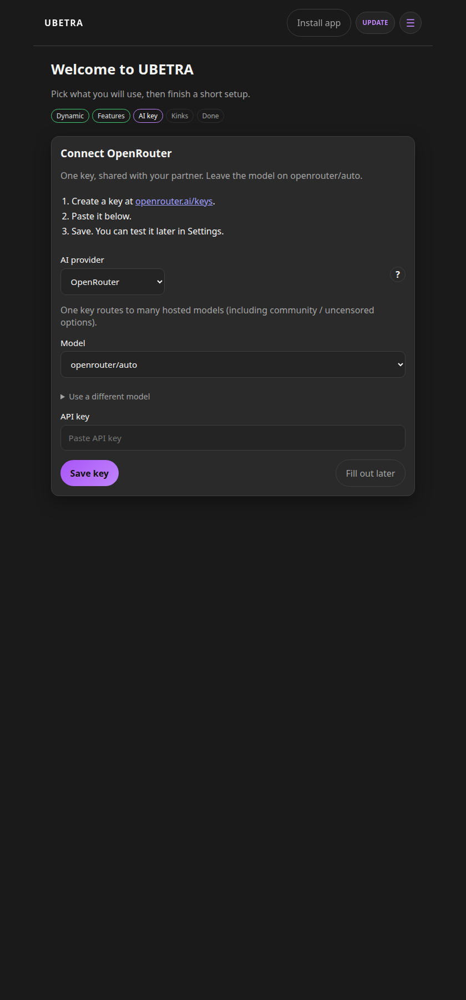
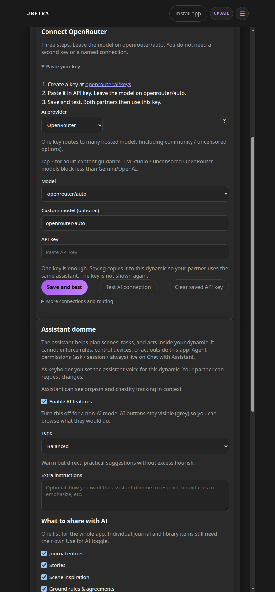
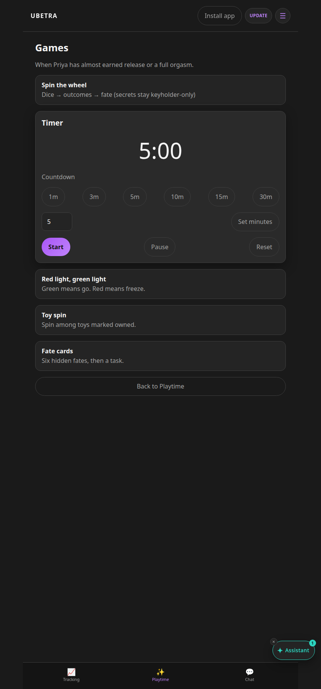
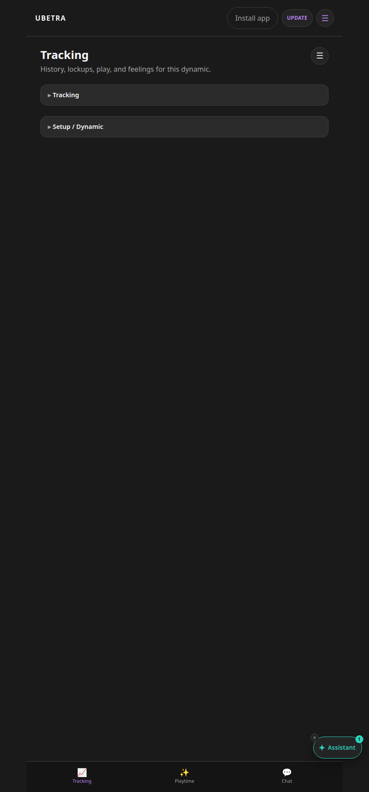
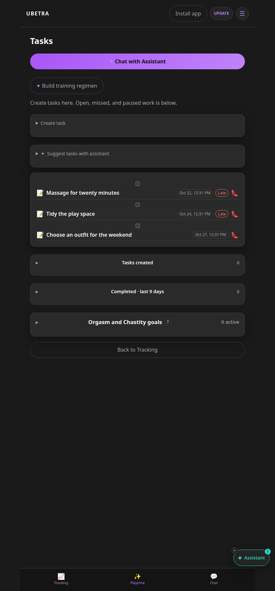
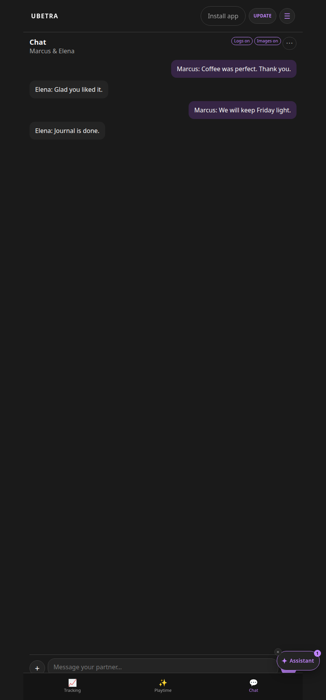
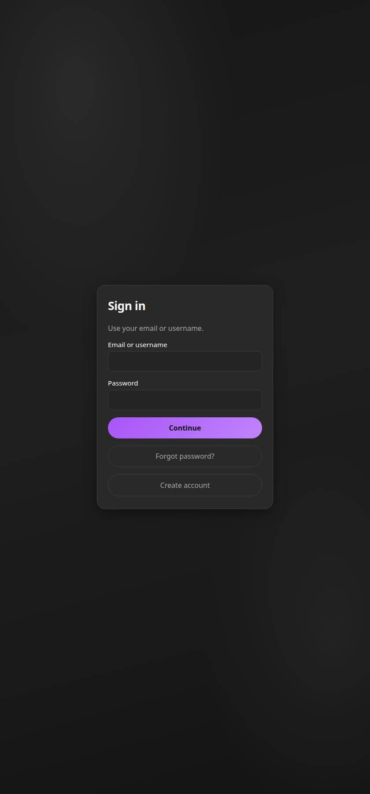

# How to use UBETRA

A short path for a fresh install, then every workflow a dynamic actually runs. Screenshots elsewhere in this wiki are from the WikiDom / WikiSub demo. Pronoun copy was checked against three extra 30-day pairings: a man and a woman, two men, and two women. The app uses each person's name, and pronouns follow biological sex (he, she, or they).

## Fresh install: OpenRouter in three steps

One key is enough. It is shared with your partner. You do not set up a second image API.

1. Create an account, then create a dynamic (you are the keyholder) or join one with an invite.
2. On **Connect OpenRouter**, the provider is already OpenRouter and the model is already `openrouter/auto`.
3. Create a key at [openrouter.ai/keys](https://openrouter.ai/keys), paste it, and tap **Save key**.

**Fill out later** skips AI. Chat, tracking, tasks, and playtime still work.

To confirm the key later: **Settings → AI & assistant → Connect OpenRouter → Save and test**. Saving copies the key onto every dynamic you belong to, so Test uses the same key the assistant uses.

A different model is under **Use a different model**. Extra named connections are under **More connections and routing**. Leave both closed on a first setup.

## Names and pronouns

Set **Biological sex** under **Settings → You**. Male copy uses he/him, female copy uses she/her, and intersex, prefer not to say, or unset uses they/them.

Wheel outcomes, games, and aftercare lines use the partner's display name ("When Elena has almost earned release", "Tell Jules only the category", "Ask if Priya wants a full orgasm now or later"). That stays readable when both partners use the same pronoun.

These three Games screens are from a 30-day demo of each pairing. The line under the title is the partner's name.

## Workflows for a dynamic

| Workflow | What happens |
|----------|----------------|
| Account | Register, sign in, optional MFA, password reset |
| Dynamic | Keyholder creates the shared space, or the partner joins with an invite |
| Features | Onboarding picks which modules are on. The keyholder can change them later |
| OpenRouter | Paste one shared key, or skip. Settings can test it |
| SPTI and kink survey | Optional personality and kink lists that feed the assistant |
| Interview and knowledge | Questions and saved answers the assistant can use |
| Ground rules | Draft an agreement. Both sides see it; the keyholder approves changes |
| Tasks | Assign, due date, complete, late, make-up, auto-punish |
| Acts of submission | Points and acts on the task timeline |
| Chastity | Lock, hygiene or sleep break, relock, eventual release, goals |
| Orgasm log | Full, ruined, edging, denied, and tags. Shows on the history calendar |
| Feelings | Check-in after play, at end of day, or when a return prompt is on |
| Punishment | Partner reports something. Keyholder assigns a task or marks it covered |
| Journal | Private or shared entries |
| Gear | Inventory, owned toys, pictures. `:` in chat offers up to five matching items |
| Scene builder | Playtime builds a scene. Owned gear pictures can go into the prompt |
| Games | Timer, red light / green light, toy spin, fate cards, spin the wheel |
| Chat | Text, photos, blur, optional end-to-end lock, calls |
| Generate image | Chat **+** menu: model, art or photo, template, prompt, then save or post |
| Vault | Full-screen pictures. Send one into chat without a second vault copy |
| Quarterly check-in | A scheduled review of the dynamic |
| Settings approval | The partner submits a change. The keyholder approves or denies it |
| Backup | Export and import the dynamic's data |
| Assistant | Tone, what it may see, and Apply cards the keyholder confirms |

Diagrams for the overlapping ones (tasks, chastity, chat, settings approval) are on [Workflows](Workflows).

## Day to day

Bottom nav is **Tracking**, **Playtime**, and **Chat**. Settings is the gear icon.

- **Tracking** is history, chastity, the orgasm log, feelings, punishment, journal, and the vault.

- **Playtime** is the assistant, scenes, gear, games, and tasks.
- **Chat** is the thread. **+** adds a photo, a vault picture, or a generated image.

The partner cannot silently change keyholder-controlled settings. Those become a request in the keyholder's inbox.
